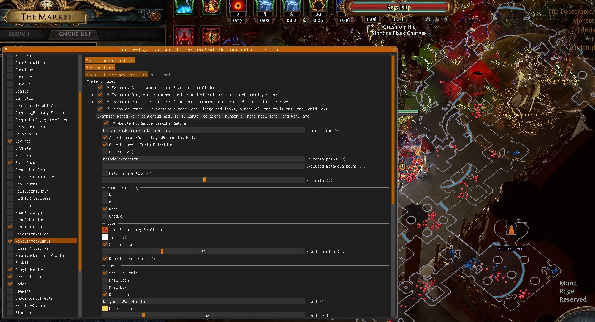

# MonsterModAlerter

An ExileApi plugin for Path of Exile 1 that marks monsters by their modifiers, buffs, metadata path and rarity.

- An icon on the map for each match, and a label, icon or box over the monster in the world
- The number of rare modifiers on the icon (optional)
- A sound when a match appears (optional)
- The icon stays on the map after the monster leaves range (optional)

## Install

Install using **PluginUpdater**: Add > paste this plugin's URL: `https://github.com/bnc-anonymous/MonsterModAlerter` > Clone

Then tick **Enable** in the plugin's settings.

## Usage

Rules are kept in groups under **Alert rules**. A new install starts with example groups, each switched off: tick one to try it.

A rule matches the game's internal names for modifiers and buffs, such as `TormentHauntedMonsterThief`, rather than the text shown in game. To find them, open **Inspect world entities** at the top of the settings: it lists the monsters around you with their modifiers, buffs and metadata paths, ready to copy into a rule.

## License

MIT
