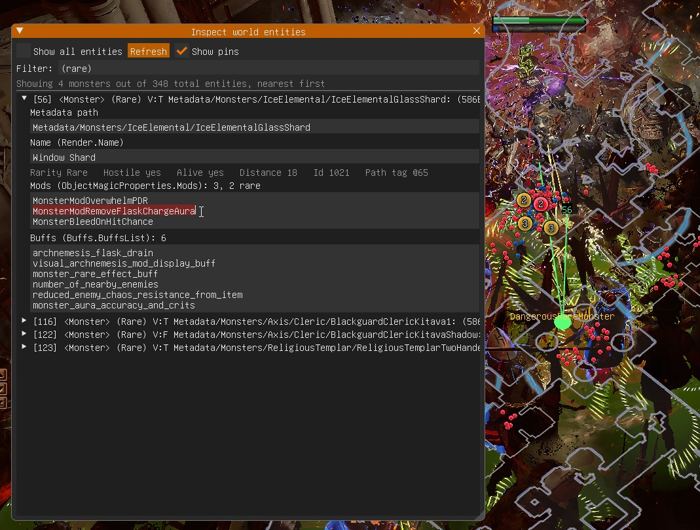

# MonsterModAlerter

An ExileApi plugin for Path of Exile 1 that allows you to mark monsters based on their modifiers, buffs, metadata path, rarity, etc.

## Features

- Customisable icons on the map and in the world
- Optionally play a sound when a monster with a chosen modifier or buff is in range
- Optionally display the number of modifiers a rare has
- An entity inspector, based on DevTree, for easily finding modifiers and buffs to copy into a rule (see second image)

## What can it do?

The example groups it comes with can:

- Highlight which rares drop lots of gold when using Allflame Ember of the Gilded
- Play a warning sound when a monster has a dangerous tormented spirit modifier
- Mark every rare with a larger icon and its number of rare modifiers (larger yellow circles in first example image)
- Pick out rares with specific modifiers, such as Siphons Flask Charges or Proximity Shield (larger red circles in first example image)
- Mark divination touched monsters
- Mark critters on the map and tally them per area
- Highlight albino critters for Krillson

## Install

Install using **PluginUpdater**: Add > paste this plugin's URL: `https://github.com/bnc-anonymous/MonsterModAlerter` > Clone

Then tick **Enable** in the plugin's settings.

## Usage

Rules are kept in groups under **Alert rules**. A new install starts with some example groups, each switched off. Tick one to enable it.

Rules match the game's internal names for modifiers and buffs, such as `TormentHauntedMonsterThief`, not the text shown in game under the monster. **Inspect world entities**, at the top of the settings, lists them for the monsters around you.

## License

MIT
